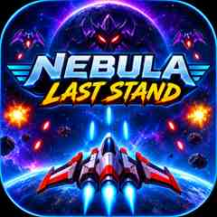

# 🌌 NEBULA: LAST STAND

<p align="center">
  
</p>

<h2 align="center">🚀 One Spaceship. Endless Enemies. One Last Stand.</h2>
<p align="center">A 2D space-shooter game built with HTML, CSS, JavaScript and Android Studio.</p>

---

## 🎮 About the Project

**NEBULA: LAST STAND** is a 2D space-shooter arcade game where players pilot a spaceship, destroy incoming enemies, fight boss battles, collect power-ups and survive increasingly challenging waves.

The project began as a browser game and was also packaged as an Android application using **Kotlin and Android WebView**. The Android APK has been installed and tested on a real Android phone.

## 📸 Screenshots

### Main gameplay

<p align="center">
  
</p>

*The game HUD displays score, health, level, lives, best score and pause controls, with joystick and button control modes.*

### App icon

<p align="center">
  
</p>

---

## ✨ Features

- 🚀 Spaceship movement and shooting
- 👾 Enemy waves and enemy projectiles
- 👑 Boss battles and bonus rewards
- ❤️ Health system and three lives
- ⚡ Power-ups: health, shield, triple shot and speed boost
- ⭐ Score, levels and best-score tracking
- ⏸️ Pause and resume
- 💥 Particle effects and star-field visuals
- 🔊 Sound effects using the Web Audio API
- 📱 Mobile-friendly touch controls with virtual joystick and FIRE button
- 💾 Best score saved with local storage
- 🌐 Playable in a web browser
- 📦 Android APK tested on a real device

## 🎯 Controls

| Action | Desktop | Mobile |
|---|---|---|
| Move | WASD / Arrow keys | Virtual joystick or on-screen buttons |
| Shoot | Space | FIRE button |
| Pause | In-game pause control | In-game pause control |

## 🛠️ Built With

| Technology | Use |
|---|---|
| HTML5 | Game structure |
| CSS3 | Interface and styling |
| JavaScript | Game mechanics |
| HTML5 Canvas | Rendering |
| Web Audio API | Sound effects |
| Local Storage | Best-score persistence |
| Kotlin | Android activity |
| Android Studio | Android build |
| Android WebView | Runs local game assets inside Android |

## 🌐 Play Online

<p align="center">
  <a href="https://tejameragala-ops.github.io/NEBULA-LAST-STAND/"><strong>🚀 PLAY NEBULA: LAST STAND</strong></a>
</p>

## 📲 Run the Browser Version Locally

1. Clone this repository:

   ```bash
   git clone https://github.com/tejameragala-ops/NEBULA-LAST-STAND.git
   ```

2. Open the project folder.
3. Open `index.html` in a modern browser.
4. Start playing!

No additional dependencies are required for the basic browser version.

## 📁 Repository Structure

```text
NEBULA-LAST-STAND/
├── index.html
├── style.css
├── game.js
├── README.md
└── screenshots/
    ├── app-logo.jpg
    └── gameplay-main.jpg
```

## 📱 Android Version

The Android app loads the game files bundled locally in the app's assets directory using a Kotlin-based Android Activity and WebView. JavaScript and DOM storage are enabled so the game can run with its browser features.

The debug APK has been built, installed and tested on a physical Android phone. Google Play Store release preparation is a future step.

## 🔭 Future Improvements

- Prepare a signed release build and Google Play Store submission
- Add more enemy types, spaceships and weapons
- Introduce additional levels and environments
- Expand visual and audio effects

## 👨‍💻 Developer

**Meragala Teja**  
B.Tech – Computer Science and Engineering (AI)

- **GitHub:** [tejameragala-ops](https://github.com/tejameragala-ops)
- **LinkedIn:** [Meragala Teja](https://www.linkedin.com/in/meragala-teja-7a5820328/)

## ⭐ Support

If you enjoyed the project, please consider giving this repository a star!

---

<p align="center">
  <strong>🌌 NEBULA: LAST STAND</strong><br/>
  <em>One Spaceship. Endless Enemies. One Last Stand.</em>
</p>
